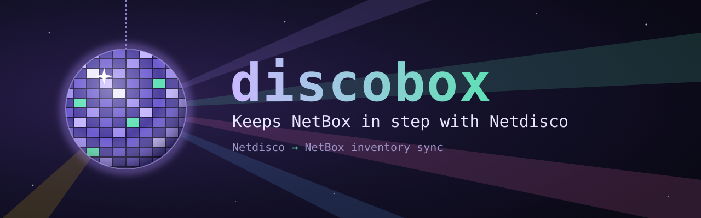
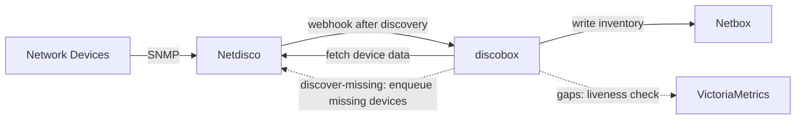
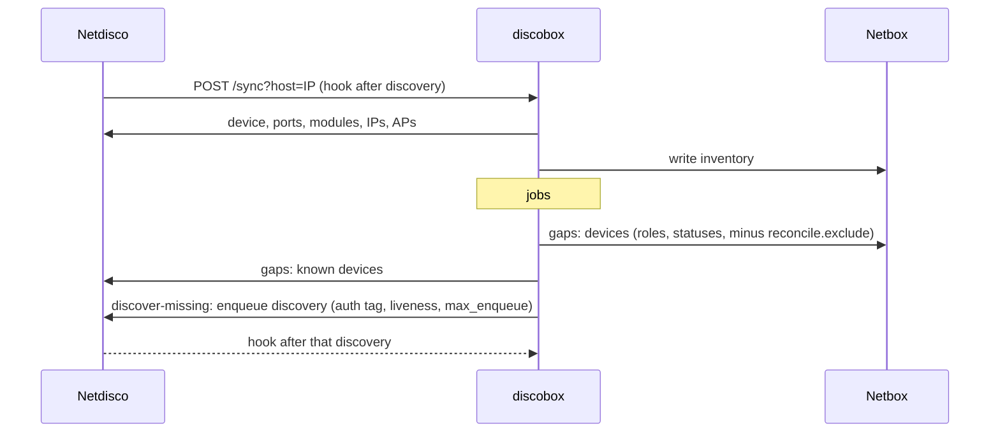
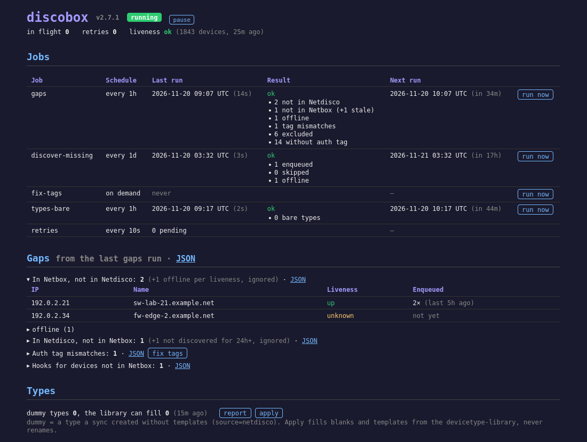

# discobox



[](https://github.com/zebbra/discobox/actions/workflows/ci.yml)
[](https://quay.io/repository/zebbra/discobox)

Syncs network device inventory from [Netdisco](https://github.com/netdisco/netdisco) into [Netbox](https://netbox.dev/), enriching existing Netbox device records with live data discovered by Netdisco.

In production with 10,000+ devices: Cisco StackWise, VSS, ACI and vPC, Wireless LAN controllers with their APs, Fortinet FortiGate HA pairs and other appliances.

Devices are matched by management IP. Hostnames are verified and a warning is logged on mismatch, but the sync proceeds regardless.

Netbox is written to directly via [pynetbox](https://github.com/netbox-community/pynetbox). [Netbox Diode](https://github.com/netbox-community/netbox-diode) was evaluated and not adopted: it adds about eight services (database, cache, auth, ingester, reconciler, proxy) plus a Netbox plugin, but takes none of the domain logic off discobox (HA/VIP resolution, stacks, the degraded-poll guard, the orphan brake, cooldowns), which a Diode producer would still need.

---

## Architecture



### Sync and reconcile loop

A sync is triggered by Netdisco's hook after each discovery. The jobs close the loop for devices Netdisco never discovers on its own: `gaps` compares both sides, `discover-missing` enqueues the Netbox devices Netdisco doesn't know, and their discovery triggers the hook again.



The status page (`/`) shows the jobs, the gap lists and the actions (sync, rebuild, discover, sync all):



A Grafana dashboard for the metrics is in [`grafana-dashboard.json`](grafana-dashboard.json) (Prometheus datasource uid `platform`; change it on import).

---

## Features

- **Device fields**: serial, OS version, OS name, OS release ([features](docs/features.md), [mapping](docs/netbox-mapping.md#device))
- **Interfaces**: physical and logical interfaces, type by name prefix, subinterface parents ([mapping](docs/netbox-mapping.md#interfaces))
- **PoE**: `poe_mode = pse` on PoE-capable ports ([features](docs/features.md))
- **MAC addresses**: `dcim.mac-addresses` as primary MAC per interface ([features](docs/features.md))
- **IP addresses**: interface IPs, prefix fixes, moves off dummy interfaces ([mapping](docs/netbox-mapping.md#ip-addresses))
- **Module bays & modules**: chassis members as module bays with modules ([mapping](docs/netbox-mapping.md#module-bays--modules))
- **Blades**: linecards, supervisors, fabric modules as module bays ([mapping](docs/netbox-mapping.md#blades-linecards--supervisors))
- **Device type auto-creation**: manufacturer and device type if missing, [type aliases](docs/netbox-mapping.md#type-aliases) first ([features](docs/features.md))
- **Cables**: from CDP/LLDP neighbors within a site, resolved by IP, MAC, name or FDB; manual cables are never touched ([mapping](docs/netbox-mapping.md#cables))
- **SFP / transceiver inventory**: inventory items linked to their interface ([mapping](docs/netbox-mapping.md#sfp--transceivers))
- **PSU inventory**: inventory items for power supplies ([features](docs/features.md))
- **HA / VIP detection**: VIP by hostname mismatch, Virtual Chassis of the HA members ([topologies](docs/netbox-mapping.md#supported-topologies))
- **Wireless APs**: APs reported by a WLC updated during its sync ([features](docs/features.md))
- **WLC HA pairs**: Cisco 9800 HA SSO pair as one device per unit in a Virtual Chassis ([features](docs/features.md))
- **DeviceType enrichment**: fill-blank from the devicetype-library, `GET`/`POST /types/library` ([features](docs/features.md))
- **Housekeeping**: stale template device bays and empty dummy interfaces removed ([features](docs/features.md))
- **Orphaned interfaces**: interfaces Netdisco doesn't report removed, with a mass-deletion brake ([features](docs/features.md))
- **Interface defaults**: fill empty interface custom fields by device custom field, e.g. `interface_severity` per team ([device rules](docs/device-rules.md#interface-defaults))
- **Gaps and discover-missing**: Netbox devices Netdisco doesn't know get enqueued for discovery; `reconcile.exclude` rules and `require_auth_tag` keep devices out ([operations](docs/operations.md#jobs), [device rules](docs/device-rules.md#reconcile-exclude))
- **Auth tag fixes**: `fix-tags` re-discovers devices whose Netdisco auth tag differs from Netbox's ([operations](docs/operations.md#jobs))
- **Primary IP refresh**: `/refresh-ip` sets the primary IPv4 from DNS, else Netdisco ([endpoints](docs/operations.md#server-endpoints))
- **Rebuild**: `/rebuild` and `/rebuild/all` match a device's inventory exactly to Netdisco, with dry run and a delete brake ([endpoints](docs/operations.md#server-endpoints))
- **Pinned devices**: a `sync.skip_tags` tag (default `pin-inventory`) keeps a device out of every sync and rebuild ([operations](docs/operations.md))
- **Metrics and alerts**: Prometheus metrics for syncs, jobs, gaps and types; Grafana dashboard ([operations](docs/operations.md))

---

## Quick start

A FastAPI server that receives webhook calls from Netdisco after each discovery and runs syncs in the background. Exposes a status page, Prometheus metrics and a Swagger UI. One process: jobs, in-flight tracking and metrics live in it. At runtime it needs no internet access: the devicetype-library and the Swagger UI assets are baked into the image at build time (build args `DEVICETYPE_LIBRARY_*`, `SWAGGER_UI_VERSION` / `SWAGGER_UI_SHA256`).

Connections and secrets come from the environment (`.env.example`), everything else from `discobox.yaml` (the annotated [`discobox.yaml`](discobox.yaml) lists every key with its default, [`examples/production.yaml`](examples/production.yaml) shows a typical production setup). See [Configuration](docs/configuration.md).

```env
NETDISCO_URL=https://netdisco.example.com
NETDISCO_TOKEN=your-long-lived-token    # preferred (Bearer prefix added automatically)
NETBOX_URL=https://netbox.example.com
NETBOX_TOKEN=your-token-here
DISCOBOX_AUTH_TOKEN=secret              # bearer token for the action endpoints; unset = no auth
```

```bash
# Docker
docker compose up -d discobox

# venv
python server.py
```

**venv setup:**
```bash
python3 -m venv .venv
source .venv/bin/activate
pip install -r requirements.txt
set -a && source .env && set +a
```

A one-off sync of one device: `curl -X POST "http://discobox:8080/sync?host=10.0.0.1"` (add `&debug=true` to get its log as plain text).

---

## Netdisco Hook

Add to your Netdisco `config.yml` to trigger a sync automatically after each device discovery:

```yaml
hooks:
  - event: discover
    action: HTTP
    url: "http://discobox:8080/sync?host=[% device.ip %]"
    method: POST
    headers:
      Authorization: "Bearer your-token"
    timeout: 30000
```

---

## Documentation

- [Configuration](docs/configuration.md): environment variables, `discobox.yaml` sections
- [Features](docs/features.md): what a sync does, per feature
- [Device rules](docs/device-rules.md): `match` syntax, `interface_defaults`, `reconcile.exclude`
- [Netbox Mapping](docs/netbox-mapping.md): field mapping, supported topologies, custom fields, type aliases
- [Operations](docs/operations.md): jobs, server endpoints, overload protection, metrics, sample log output
