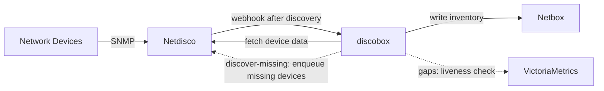

# discobox


[](https://github.com/zebbra/discobox/actions/workflows/ci.yml)
[](https://quay.io/repository/zebbra/discobox)

Syncs network device inventory from [Netdisco](https://github.com/netdisco/netdisco) into [Netbox](https://netbox.dev/), enriching existing Netbox device records with live data discovered by Netdisco.

Devices are matched by management IP. Hostnames are verified and a warning is logged on mismatch, but the sync proceeds regardless.

Netbox is written to directly via [pynetbox](https://github.com/netbox-community/pynetbox) for simplicity. Migration to [Netbox Diode](https://github.com/netbox-community/netbox-diode) is a future consideration once its entity coverage matures.

---

## Architecture



---

## Features

- **Device fields**: serial, OS version, OS name, OS release ([features](docs/features.md), [mapping](docs/netbox-mapping.md#device))
- **Interfaces**: physical and logical interfaces, type by name prefix, subinterface parents ([mapping](docs/netbox-mapping.md#interfaces))
- **PoE**: `poe_mode = pse` on PoE-capable ports ([features](docs/features.md))
- **MAC addresses**: `dcim.mac-addresses` as primary MAC per interface ([features](docs/features.md))
- **IP addresses**: interface IPs, prefix fixes, moves off dummy interfaces ([mapping](docs/netbox-mapping.md#ip-addresses))
- **Module bays & modules**: chassis members as module bays with modules ([mapping](docs/netbox-mapping.md#module-bays--modules))
- **Blades**: linecards, supervisors, fabric modules as module bays ([mapping](docs/netbox-mapping.md#blades-linecards--supervisors))
- **Device type auto-creation**: manufacturer and device type if missing, [type aliases](docs/netbox-mapping.md#type-aliases) first ([features](docs/features.md))
- **SFP / transceiver inventory**: inventory items linked to their interface ([mapping](docs/netbox-mapping.md#sfp--transceivers))
- **PSU inventory**: inventory items for power supplies ([features](docs/features.md))
- **HA / VIP detection**: VIP by hostname mismatch, Virtual Chassis of the HA members ([topologies](docs/netbox-mapping.md#supported-topologies))
- **Wireless APs**: APs reported by a WLC updated during its sync ([features](docs/features.md))
- **WLC HA pairs**: Cisco 9800 HA SSO pair as one device per unit in a Virtual Chassis ([features](docs/features.md))
- **DeviceType enrichment**: fill-blank from the devicetype-library, `GET`/`POST /types/library` ([features](docs/features.md))
- **Housekeeping**: stale template device bays and empty dummy interfaces removed ([features](docs/features.md))
- **Orphaned interfaces**: interfaces Netdisco doesn't report removed, with a mass-deletion brake ([features](docs/features.md))
- **Interface defaults**: fill empty interface custom fields by device custom field, e.g. `interface_severity` per team ([features](docs/features.md))

---

## Quick start

A FastAPI server that receives webhook calls from Netdisco after each discovery and runs syncs in the background. Exposes a status page, Prometheus metrics and a Swagger UI. One process: jobs, in-flight tracking and metrics live in it. At runtime it needs no internet access: the devicetype-library and the Swagger UI assets are baked into the image at build time (build args `DEVICETYPE_LIBRARY_*`, `SWAGGER_UI_VERSION` / `SWAGGER_UI_SHA256`).

Connections and secrets come from the environment (`.env.example`), everything else from `discobox.yaml` (the annotated [`discobox.yaml`](discobox.yaml) in this repo lists every key with its default). See [Configuration](docs/configuration.md).

```env
NETDISCO_URL=https://netdisco.example.com
NETDISCO_TOKEN=your-long-lived-token    # preferred (Bearer prefix added automatically)
NETBOX_URL=https://netbox.example.com
NETBOX_TOKEN=your-token-here
DISCOBOX_AUTH_TOKEN=secret              # bearer token for the action endpoints; unset = no auth
```

```bash
# Docker
docker compose up -d discobox

# venv
python server.py
```

**venv setup:**
```bash
python3 -m venv .venv
source .venv/bin/activate
pip install -r requirements.txt
set -a && source .env && set +a
```

A one-off sync of one device: `curl -X POST "http://discobox:8080/sync?host=10.0.0.1"` (add `&debug=true` to get its log as plain text).

---

## Netdisco Hook

Add to your Netdisco `config.yml` to trigger a sync automatically after each device discovery:

```yaml
hooks:
  - event: discover
    action: HTTP
    url: "http://discobox:8080/sync?host=[% device.ip %]"
    method: POST
    headers:
      Authorization: "Bearer your-token"
    timeout: 30000
```

---

## Interface defaults

`interface_defaults` fills interface custom fields where they're empty, on every sync of a device that matches a rule. The rules work like the ones in [snmp-modulator](https://github.com/zebbra/snmp-modulator): `match` maps a dotted path on the NetBox device (`status.value`, `role.slug`, `site.slug`, `device_type.manufacturer.slug`, `custom_fields.<name>`, `tags`, ...) to a regex. Every key must match (`re.fullmatch`, case-insensitive). A list field (tags by slug, multi-select) matches when any element does. An object custom field needs its attribute, e.g. `custom_fields.team.slug`.

`set` maps interface custom fields to their value. A value already set is never overwritten, a deliberate `none` included; a value cleared by hand is filled again on the next sync, so set `none` to opt a port out. Per field, the first rule that matches and covers the interface wins. `physical_only` (default `true`) skips virtual (SVI, tunnel, loopback), LAG, bridge and wireless interfaces. A field that doesn't exist on Interface is skipped with a warning, and a value must be a valid choice of its field.

One severity for two teams:

```yaml
interface_defaults:
  - name: team severity
    match:
      custom_fields.service_team: "netops|campus"
    set:
      interface_severity: warning
```

Tiered, the first matching rule wins (active core switches get `critical` and a monitoring profile, the rest of netops `warning`):

```yaml
interface_defaults:
  - name: core
    match:
      role.slug: "core-.*"
      status.value: active
    set:
      interface_severity: critical
      monitoring_profile: full
  - name: netops
    match:
      custom_fields.service_team: netops
    set:
      interface_severity: warning
```

By tag, including virtual interfaces:

```yaml
interface_defaults:
  - name: branch
    match:
      tags: branch
      site.slug: "br-.*"
    set:
      monitoring_profile: standard
    physical_only: false
```

Existing devices get their values on their next sync; to backfill right away: `curl -X POST "http://discobox:8080/sync/all?cf_service_team=netops&force=true"` (extra parameters are NetBox device filters). Metric `discobox_interface_defaults_total{field}`. A debug sync (`/sync?host=...&force=true&debug=true`) logs every rule key as `MATCH`/`MISS` with its pattern and value.

---

## Documentation

- [Configuration](docs/configuration.md): environment variables, `discobox.yaml` sections
- [Features](docs/features.md): what a sync does, per feature
- [Netbox Mapping](docs/netbox-mapping.md): field mapping, supported topologies, custom fields, type aliases
- [Operations](docs/operations.md): jobs, server endpoints, overload protection, metrics, sample log output
